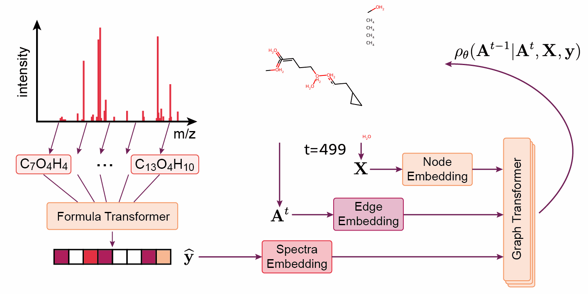

# Annotix ML -- Predict unknown molecular structures from MS/MS spectra using machine learning.

## Presentation

The goal of this package is to introduce a framework to create graph transformers
able to generate molecular structures through a diffusion process guided by the
MS2 spectrum of an unknown coumpound.

The generation follows the method introduced in [Digress](https://arxiv.org/abs/2209.14734)
for the Graph transformers and diffusion process. The MS2 addition uses the
[DiffMs](https://arxiv.org/abs/2502.09571) methodology as well as their spectrum
encoder.



## Install

This package is managed with `uv` for dependency management and is `pip`
install compatible.
In order to install the package first create a `venv`, install `pytorch` with
the extras specific to your gpus and then run `uv pip install .` or `pip install .`


## Package organisation

Extensive documentation about the organisation of this package can be found
within the `docs` folder.


### Quick Start

```bash
# Training
python annotix_ml/graphtransf/train/train.py \
    --config configs/graphtransf/qm9/medium_arch/long.yaml

# Molecule generation (here btw 20 and 30 heavy atoms)
python annotix_ml/graphtransf/generate_molecules.py \
    --save-dir path/to/saved/dir \
    --num-samples 100 \
    --min-nodes 20 \
    --max-nodes 30 \
    --output-path path/to/results/smiles
```

### Distributed Training with torchrun

Use `torchrun` to launch data-parallel (DDP) training across multiple GPUs.
Set `model.distributed_strategy: "data"` in your config.

**Single node, multiple GPUs:**

```bash
torchrun \
    --standalone \
    --nproc_per_node 4 \
    annotix_ml/graphtransf/train/train.py \
    --config configs/graphtransf/qm9/medium_arch/long.yaml \
    --distributed-strat data
```

## Datasets

Different datasets exists for this project.

### 1. SMILES only molecules

These datasets contain only molecular structures (SMILES) and are used for
pretraining the graph diffusion model.

| Dataset | Molecules | Heavy atoms | Atom types | Description |
|---------|----------:|:-----------:|------------|-------------|
| `qm9` | 133,885 | 1 -- 9 | C, F, N, O | Small molecules. Useful to quickly test if a model learns without a long training |
| `moses` | 1,936,962 | 8 -- 27 | Br, C, Cl, F, N, O, S | Medium sized drug-like molecules. A step above QM9 to test scaling |
| `preprocessed` | 3,122,845 | 1 -- 111 | C, Cl, F, N, O, P, S | Molecules of all sizes. Combination of datasets extracted from [DiffMs](https://github.com/coleygroup/DiffMS). Used to pretrain the graph transformer |

### 2. SMILES / MS2 datasets

These datasets pair molecular structures with MS/MS spectra and are used for
spectrum-conditioned molecule generation.

| Dataset | MS2 pairs | Unique molecules | Heavy atoms | Atom types | Description |
|---------|----------:|:----------------:|:-----------:|------------|-------------|
| `msg` | 231,104 | 31,602 | 4 -- 72 | As, B, Br, C, Cl, F, I, N, O, P, S, Se, Si | Data from [MassSpecGym](https://arxiv.org/abs/2410.23326). Diverse open MS/MS databases with careful train/eval separation |
| `POS_LC` | 2,389,040 | 141,547 | 4 -- 238 | Al, As, B, Br, C, Cl, Co, Cr, F, Fe, I, K, Mg, N, Na, O, P, Pt, S, Se, Si, Sn | Data collected by the Banyuls team. Large variety of molecules / MS2 pairs from positive LC-MS |

> In SMILES / MS2 datasets a same molecule is often present several times with
> different MS2 spectra.


## MS2 spectra treatment

MS2 spectras are transformed into an "estimated" fingerprint in order to be added
to the model.
To do that we use the spectraencoder that was implemented by [mist-cf](https://github.com/samgoldman97/mist-cf),
which looks for the following fields in the given data :
